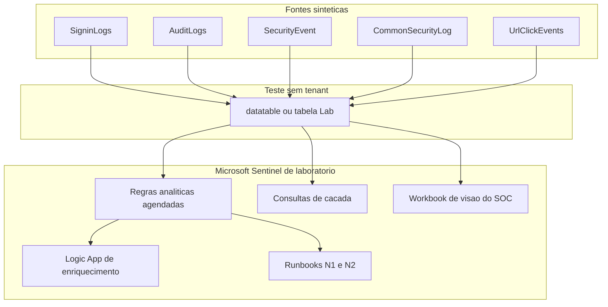

# Laboratório de SOC com Microsoft Sentinel

Mantido por **Kleidson Almeida Santos**, engenheiro de backend em transição para analista SOC N1/N2.

Este repositório é um laboratório. Os logs são **sintéticos**. Não há tenant, segredo, identificador de diretório nem cópia de ambiente real. As contas usam o domínio fictício `contoso-lab.example` e os endereços IP das redes de documentação da RFC 5737. Nada aqui deve ser implantado em produção.

As regras seguem o formato YAML da comunidade do Microsoft Sentinel (regra agendada, com KQL, tática, técnica, entidade e severidade). Dá para executar cada consulta sem workspace, com `datatable()`.

## Arquitetura



O `datatable()` só existe na consulta de teste. A regra implantada continua lendo o nome canônico da tabela (`SigninLogs`, `AuditLogs`, `SecurityEvent`, `CommonSecurityLog`, `UrlClickEvents`).

## Como executar

Pré-requisitos para a validação local: Python 3.12 e .NET 8. A implantação pede Azure CLI, numa assinatura que você possa apagar.

```bash
python -m pip install -r tools/requirements.txt
python tools/validate_content.py
dotnet run --project tools/kql-lint --configuration Release -- .kql-build sample-data/runnable
```

`tools/validate_content.py` confere o schema YAML, a presença de tática e técnica MITRE, o vínculo de cada regra com o runbook e se a amostra sintética dispara o cenário esperado. O projeto `tools/kql-lint` usa o analisador `Kusto.Language` e falha em erro de sintaxe.

### Consulta sem tenant

Abra `sample-data/runnable/<nome>.kql` no Log Analytics ou num cluster gratuito do Azure Data Explorer e execute. O arquivo começa com `let Tabela = datatable(...)` usando os eventos de `sample-data/`. O passo a passo está em [sample-data/README.md](sample-data/README.md).

Para persistir os mesmos eventos num cluster de estudo, use `sample-data/adx/create-and-ingest.kql`. As tabelas criadas levam o prefixo `Lab`.

### Workspace de laboratório

```bash
az group create --name rg-sentinel-lab --location brazilsouth
az deployment group create \
  --resource-group rg-sentinel-lab \
  --template-file infra/main.bicep \
  --parameters infra/dev.bicepparam
```

O Bicep cria o workspace e habilita o Sentinel, com retenção de 30 dias e teto de 1 GB por dia. Mesmo assim há custo. Apague o grupo de recursos no fim do exercício. Detalhes em [infra/README.md](infra/README.md).

Cada regra também tem um modelo ARM em `detections/arm/`. A regra nasce **desligada**. Passe o nome do workspace:

```bash
az deployment group create \
  --resource-group rg-sentinel-lab \
  --template-file detections/arm/brute-force-signin.json \
  --parameters workspaceName=law-sentinel-lab
```

O playbook de enriquecimento está em [playbooks/README.md](playbooks/README.md). Ele comenta o incidente, avisa o Teams e envia e-mail. Não desativa usuário.

## Detecções

| Regra | Severidade | Tática | MITRE ATT&CK |
| --- | --- | --- | --- |
| Força bruta em entradas do Entra ID | High | Credential Access | T1110, T1110.001 |
| Password spray em entradas do Entra ID | High | Credential Access | T1110, T1110.003 |
| Viagem impossível em entrada bem-sucedida | Medium | Initial Access, Credential Access | T1078, T1078.004 |
| Entrada externa negada em porta administrativa | Medium | Initial Access, Lateral Movement | T1133, T1021, T1021.001 |
| Exclusão em massa de arquivos | High | Impact | T1485 |
| Volume anômalo de saída para IP público | High | Exfiltration | T1048, T1567 |
| Nova atribuição de função privilegiada | High | Persistence, Privilege Escalation | T1098, T1098.003 |
| Clique permitido em URL de phishing | Medium | Initial Access | T1566, T1566.002 |

Cada YAML traz `entityMappings`, severidade e o campo `falsePositives`. O campo de falso positivo é documentação deste laboratório: o import da regra para o Sentinel usa as propriedades da API, geradas em `detections/arm/`. O runbook correspondente fica em `playbooks/runbooks/` e descreve o passo do N1, o prazo e a escalação para o N2.

Prazos usados nos runbooks, como convenção de estudo:

| Severidade | Início do N1 | Escalar ao N2 |
| --- | --- | --- |
| High | 15 minutos | 30 minutos, se não for falso positivo claro |
| Medium | 60 minutos | 4 horas, se o sinal permanecer sem dono |

## Caçadas

Consultas em `hunting/`, no mesmo formato YAML, sem agendamento:

- Entradas com protocolo de autenticação legado
- Falhas de entrada em vários aplicativos
- Logon interativo fora do horário do laboratório
- PowerShell com conteúdo codificado
- Mudança de função fora do horário do laboratório
- Domínios externos em cliques permitidos

A janela 08:00–19:00 UTC é só deste conjunto de eventos. Numa operação real ela segue o fuso da equipe.

## Workbook

`workbooks/soc-overview.json` é um workbook de visão do SOC:

- alertas por severidade (`SecurityAlert` / `AlertSeverity`)
- principais entidades (`CompromisedEntity`)
- falhas de entrada ao longo do tempo (`SigninLogs`)

`SecurityAlert` só enche depois que uma regra agendada dispara. As falhas de entrada aparecem assim que `SigninLogs` tem dado, inclusive o sintético.

## O que a validação cobre

O workflow [`.github/workflows/validate.yml`](.github/workflows/validate.yml) roda em pull request e faz três checagens:

1. Schema JSON das regras e das caçadas, incluindo tática, técnica, severidade e mapeamento de entidade.
2. Lista fechada de técnicas em `schemas/mitre-techniques.txt`, para um ID inventado não passar.
3. Sintaxe KQL com `Microsoft.Azure.Kusto.Language`.

A amostra também é confrontada com os limiares escritos nas consultas, para o cenário sintético continuar disparando a regra certa e só ela.

## Limites honestos

- Os limiares (10 falhas, 8 contas, 25 arquivos, 100 MB, 120 minutos) são ponto de partida de laboratório, não baseline de uma rede real.
- A lista de TLD e de domínio parecido na regra de phishing não substitui reputação.
- `UrlClickEvents` aqui é um subconjunto didático da tabela do Microsoft 365 Defender.
- O enriquecimento de IP do playbook usa, por padrão, um serviço público sem chave. Não aponte incidente real para esse endereço.
- Não há conteúdo de produção neste repositório.
